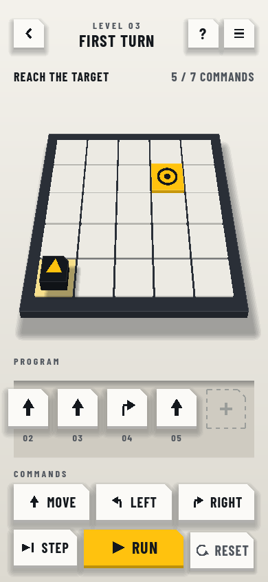
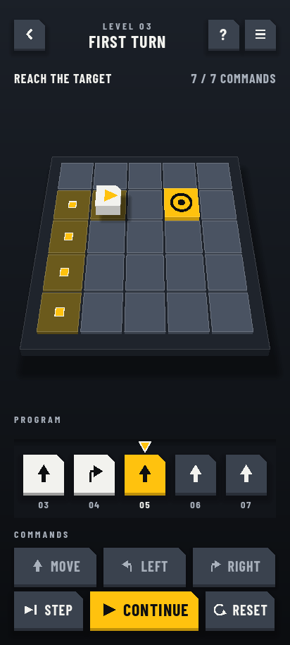

# Algomind

**Think like a programmer. Solve puzzles by writing programs.**

Algomind is a puzzle game for Android. Each level is a small board with a target. You build a program from instruction tiles, press Run, and watch a little automaton carry it out one step at a time. If it misses, you see exactly where and why, fix the program, and try again. No timer, no lives, no joystick, and you never need to know how to code.

[](https://github.com/shahadathhs/Algomind/actions/workflows/ci.yml)

| Download and play                                          | Backend                                                             |
| ---------------------------------------------------------- | ------------------------------------------------------------------- |
| [playalgomind.vercel.app](https://playalgomind.vercel.app) | [algomind-api.onrender.com](https://algomind-api.onrender.com/docs) |

<p align="center">
  
  
  
</p>

## What you do

1. **Look** at the board: walls, a target, and an automaton facing some way.
2. **Plan** a short program on the tape from a handful of tiles.
3. **Run** it, or step through it one instruction at a time.
4. **Fix** it. When the automaton hits a wall the game says so in plain words and marks the instruction that caused it.

Many levels limit how many tiles you may use, so the shortest idea wins. A built-in solver knows the best possible program (the par), and your result is shown against it.

## What you learn

The campaign has **13 worlds and 71 levels**. Each world teaches one idea, and the ramp is quick: loops arrive by level 11.

| World  | Idea                     | What it adds                                                      |
| ------ | ------------------------ | ----------------------------------------------------------------- |
| 1 to 2 | Sequences, turns, routes | Move, Turn Left, Turn Right                                       |
| 3 to 4 | Loops                    | Repeat, Repeat until                                              |
| 5 to 6 | Decisions                | If with sensors, following a wall                                 |
| 7      | Reuse                    | Named procedures you can call again                               |
| 8      | Debugging                | A broken program is on the tape; find the bug                     |
| 9      | Generalising             | One program must solve several boards                             |
| 10     | State                    | A counter that changes each lap                                   |
| 11     | Memory                   | Breadcrumbs and the search that never repeats a path              |
| 12     | Coverage                 | Visit every cell, efficiently                                     |
| 13     | Timing                   | Guards walk a fixed route; read the pattern, then time your moves |

More worlds are on the way: keys and doors, delivery, switches, ice, teleporters, recursion and a final test of everything. The plan is in the [roadmap](docs/README_ROADMAP.md).

## Good to know

- **Fair.** The same level and the same program always give the same result.
- **Works offline.** Progress saves on your device and downloaded levels stay playable without a connection.
- **Optional account.** Sign in only to sync progress between devices. Signed-out play uploads nothing.
- **New levels without an update.** Levels are data, published from a dashboard and downloaded by the app.
- **Daily challenge, points and leaderboards** for when you want to compare with others.
- **No ads, no purchases, no tracking.** The website uses no third-party scripts.
- **Light and dark themes**, with every state readable without relying on colour.

## Install

Algomind is distributed as an Android APK from [GitHub Releases](https://github.com/shahadathhs/Algomind/releases), with install steps on the [website](https://playalgomind.vercel.app). It is not on Google Play.

## For developers

Algomind is a monorepo.

```text
apps/
  game/            Godot 4 (GDScript), Android first
  api/             NestJS, Prisma, PostgreSQL
  web/             Next.js: public site and the level dashboard
packages/
  level-contract/  Level schema, validator, simulator, solver, shared fixtures
  design-tokens/   The single source of colours for the game and the web
docs/              Specification, design renders, CI and deployment notes
```

The game and the TypeScript reference simulator implement the same rules and must pass the same fixtures, so the dashboard preview, the API's publish check and the game always agree. A level can only be published once it validates, its reference solution solves it, it has been playtested, and the deployed app can play it.

| Part     | Technology                                        |
| -------- | ------------------------------------------------- |
| Game     | Godot 4.7, GDScript, GUT                          |
| API      | NestJS (ES modules, SWC), Prisma 7, PostgreSQL 17 |
| Web      | Next.js 16, React 19, Tailwind CSS 4              |
| Shared   | TypeScript 7, pnpm workspace                      |
| Delivery | Docker, GitHub Actions, Render, Neon, Vercel      |

## Getting started

You need Node 22+, pnpm, Docker, and `make`. For the game you also need Godot 4.7 and [uv](https://docs.astral.sh/uv/) (or use the Docker targets).

```sh
make setup      # .env (with a generated local database password), dependencies and hooks, database in Docker, migrations, Godot cache
make api-dev    # API at http://localhost:8000 (docs at /docs)
make web-dev    # web at http://localhost:3000
make game-run   # the game on this machine
make game-shots # debug screenshots of every screen (3 phone sizes, both themes) into apps/game/build/shots
```

Or run everything in containers:

```sh
make up         # database, API, and web (http://localhost:3000, http://localhost:8000)
make down       # stop
```

## Commands

`make help` lists everything. The common ones:

```sh
make check              # everything CI runs
make lint               # oxlint (type-aware) + prettier --check
make typecheck          # tsc in every TypeScript package
make test               # TypeScript tests
make game-test          # GDScript tests (GUT, includes the contract fixtures); make game-docker-test runs them in a container
make tokens-check       # fail if generated design-token files are out of date
make colors-check       # fail if a color is hand-written outside the design tokens
make size-check         # fail if a source file is over 450 lines (lists files over 300)
make web-smoke          # browser test of the dashboard publish flow (running API and web, Chrome, E2E_EMAIL and E2E_PASSWORD)
make api-smoke          # smoke test of the social API (running API and database)
make api-generate       # generate the Prisma client (not committed)
make game-bundle        # refresh the game's bundled levels from a running API
make db-reset           # throw away the local database and start fresh
make game-apk           # build a debug APK (in the Godot container)
make version v=0.2.0    # bump the version everywhere (no git); make release also commits and pushes
```

## Quality and delivery

- **Gates on every push and pull request:** design-token drift, hand-written colors, type-aware lint and formatting, type checks, tests, a clean-database migration check for the API, production builds, GDScript lint and headless Godot tests, and a container smoke test that starts the database, API, and web together.
- **On `main`:** deploy the API to Render and wait for it to go live, build a signed debug APK, refresh a rolling "latest build" release, and publish a versioned release when the `VERSION` file names a new version.
- **Conventional Commits** are enforced by a hook. Work happens on `dev` and reaches `main` through a pull request.

Details: [CI, CD, and releases](docs/CI.md) and [deployment](docs/DEPLOY.md).

## Docs

- [Project overview](docs/README_PROJECT_OVERVIEW.md): goals, scope, success criteria
- [Game rules](docs/README_GAME_RULES.md): commands, execution, progress, sync, publishing
- [Gameplay and features](docs/README_GAMEPLAY_FEATURES.md)
- [Visual design](docs/README_VISUAL_DESIGN.md) and [screens](docs/design/SCREENS.md)
- [Architecture](docs/README_ARCHITECTURE.md)
- [Code standards](docs/README_CODE_STANDARDS.md): file size, module structure, reuse rules
- [Public website plan](docs/README_WEB_PLAN.md) and [admin dashboard plan](docs/README_DASHBOARD_PLAN.md)
- [Roadmap](docs/README_ROADMAP.md), [World restructure plan](docs/README_WORLD_RESTRUCTURE_PLAN.md), [Depth look plan](docs/README_3D_VIEW_PLAN.md), [TODO](TODO.md), and [code review](CODE_REVIEW.md)
- [Points, leaderboards, daily challenge, and sharing plan](docs/README_SOCIAL_PLAN.md)
- [Implementation plan](docs/README_IMPLEMENTATION_PLAN.md)
- [CI, CD, and releases](docs/CI.md) and [deployment](docs/DEPLOY.md)

## Contributing

See [CONTRIBUTING.md](CONTRIBUTING.md) for setup and house rules, and [AGENTS.md](AGENTS.md) for the rules AI coding tools follow here. Everyone is expected to follow the [Code of Conduct](CODE_OF_CONDUCT.md).

## License

[MIT](LICENSE)

## Security

Report vulnerabilities privately; see [SECURITY.md](SECURITY.md).
