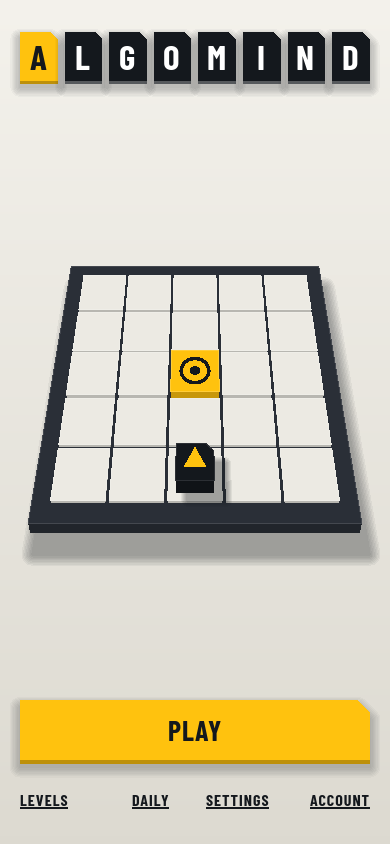
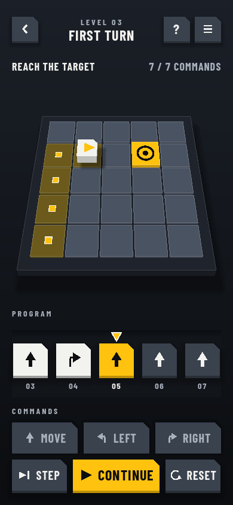
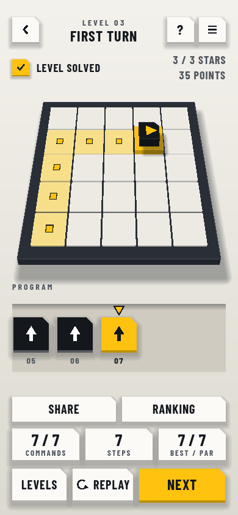
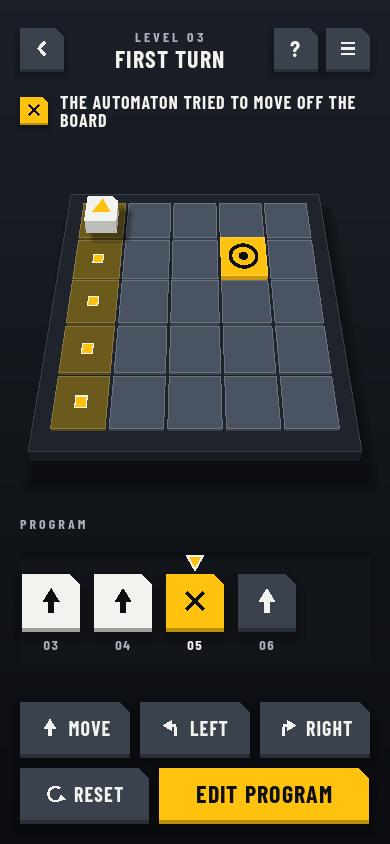
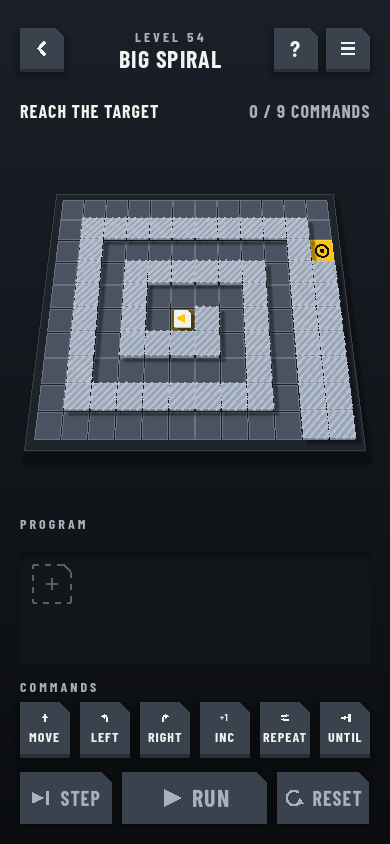
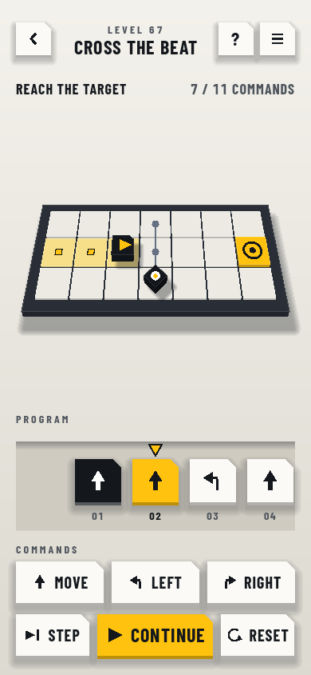
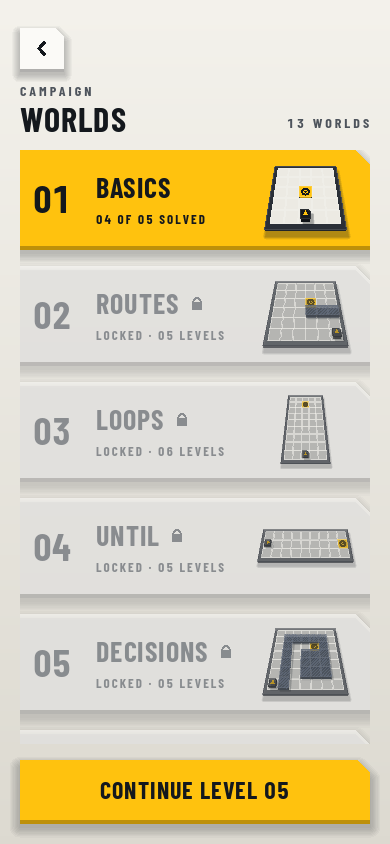
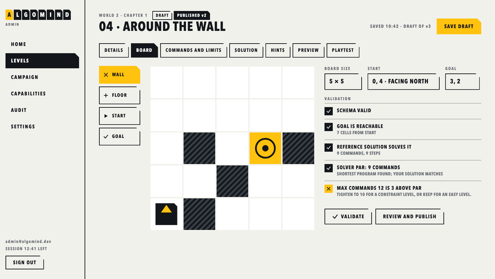

<p align="center">
  
</p>

<h1 align="center">Algomind</h1>

<p align="center">
  <b>A puzzle game where the moves are a program you write.</b><br>
  Plan it, run it, watch it fail, fix it. For Android, offline, free.
</p>

<p align="center">
  <a href="https://playalgomind.vercel.app/play"><b>Play in the browser</b></a> ·
  <a href="https://github.com/shahadathhs/Algomind/releases/latest"><b>Download the APK</b></a> ·
  <a href="https://playalgomind.vercel.app">Website</a> ·
  <a href="docs/README_ROADMAP.md">Roadmap</a> ·
  <a href="https://algomind-api.onrender.com/docs">API docs</a>
</p>

<p align="center">
  <a href="https://github.com/shahadathhs/Algomind/actions/workflows/ci.yml"></a>
  <a href="https://github.com/shahadathhs/Algomind/releases/latest"></a>
  
  <a href="LICENSE"></a>
</p>

<p align="center">
  
  
  
  
</p>

## What it is

You do not steer the automaton. You **write the instructions** it will follow, from a handful of tiles, then press Run and watch it carry them out one step at a time. When it walks into a wall, the game says so in plain words and marks the tile that caused it. No timer, no lives, no reflexes, and no code to type.

It is built to teach how programmers think: sequences, loops, decisions, reuse, debugging, state, search, and timing, one idea per world, with a ramp quick enough that loops arrive by level 11.

## A level, in thirty seconds

```text
  . . . G          Move  Move  Move  Turn right  Move  Move  Move
  . # # .
  . . . .          7 tiles, the shortest without loops.
  ^ . . .
```

The automaton `^` starts bottom-left facing north, and you must reach the target `G`. Many levels cap the tile count, and a built-in solver knows the shortest possible program (the **par**), so the result screen shows yours next to it. Any valid solution counts.

<p align="center">
  
  
  
  
</p>

## The campaign

**14 worlds, 77 levels**, unlocked in order. Each world teaches one idea.

| World                        | You learn                                | New in the toolbox                   |
| ---------------------------- | ---------------------------------------- | ------------------------------------ |
| 1 Basics, 2 Routes           | Order matters; plan around walls         | Move, Turn left, Turn right          |
| 3 Loops, 4 Until             | Do it again; stop when something is true | Repeat, Repeat until                 |
| 5 Decisions, 6 Wall follower | Look, then choose                        | If, sensors (wall, clear, goal)      |
| 7 Procedures                 | Name a piece and reuse it                | Proc, Call                           |
| 8 Debug                      | Read a broken program and fix it         | A program is already on the tape     |
| 9 Generalize                 | One program, several boards              | Test boards                          |
| 10 Counters                  | A number that changes each lap           | Counter, loops in loops              |
| 11 Memory                    | Remember where you have been             | Breadcrumbs, the Trémaux search      |
| 12 Sweep                     | Cover everything efficiently             | Visit every cell                     |
| 13 Patrol                    | Timing: guards walk a fixed route        | Read the pattern, then wait or dodge |
| 14 Keys                      | Fetch what you need before you need it   | Keys and doors                       |

## Make your own levels

Levels are data, not app code. A dashboard lets an author draw a board, solve it on the same tape editor the game uses, and publish it. The solver computes par, and a level cannot go live until it validates, its reference solution solves it, it has a recorded playtest, and the deployed app can play it. Published versions never change; edits make a new draft. Players download new levels without updating the app.

<p align="center">
  
</p>

## Play it

- **Browser:** [playalgomind.vercel.app/play](https://playalgomind.vercel.app/play), a try-out build with no account.
- **Android:** download the APK from [Releases](https://github.com/shahadathhs/Algomind/releases/latest) (installation steps are on the [website](https://playalgomind.vercel.app/download)). It is not on Google Play.

Everything works offline. Progress saves on your device; sign in only if you want it synced between devices (local and cloud progress are merged, never overwritten). Signed-out play uploads nothing. There are no ads, no purchases and no tracking, and the website loads no third-party scripts. Both light and dark themes are supported, and no state relies on colour alone.

When you want company there is a daily challenge, points, leaderboards and achievements.

## Roadmap

**Shipped:** the 13-world campaign, accounts and sync, the daily challenge and leaderboards, the level dashboard, the public site, and the depth look (a soft, tilted 2.5D board).

**Next:** six more worlds, taking the campaign to 20.

| World                | Idea                              |
| -------------------- | --------------------------------- |
| 15 Delivery          | Carry an item to a place          |
| 16 Switches          | Cause and effect across the board |
| 17 Ice and conveyors | Forced movement                   |
| 18 Teleporters       | Shortcuts that need planning      |
| 19 Recursion         | A procedure that calls itself     |
| 20 Capstone          | Everything together               |

The plan, with the reasons for this order, is in the [world restructure plan](docs/README_WORLD_RESTRUCTURE_PLAN.md) and the [roadmap](docs/README_ROADMAP.md).

## Under the hood

```text
  Game (Godot, Android)  ──HTTPS──▶  API (NestJS, Prisma)  ──▶  PostgreSQL
                                          ▲
  Web (Next.js): public site + level dashboard ┘

  packages/level-contract   schema, validator, simulator, solver, shared fixtures
  packages/design-tokens    the one source of colours for the game and the web
```

- **One rule set, two implementations.** The TypeScript reference simulator and the game's GDScript simulator must pass the same language-neutral fixtures, so the dashboard preview, the API's publish check and the game always agree.
- **Simulation is separate from animation.** Runs are deterministic and never depend on frame rate, network or time; animations only display what the simulation decided.
- **The server is the authority.** The API validates everything the client validates.

| Part     | Technology                                        |
| -------- | ------------------------------------------------- |
| Game     | Godot 4.7, GDScript, GUT                          |
| API      | NestJS (ES modules, SWC), Prisma 7, PostgreSQL 17 |
| Web      | Next.js 16, React 19, Tailwind CSS 4              |
| Shared   | TypeScript 7, pnpm workspace                      |
| Delivery | Docker, GitHub Actions, Render, Neon, Vercel      |

## Run it locally

You need Node 22+, pnpm, Docker, and `make`. For the game you also need Godot 4.7 and [uv](https://docs.astral.sh/uv/) (or use the Docker targets).

```sh
make setup      # .env (with a generated local database password), dependencies and hooks, database in Docker, migrations, Godot cache
make api-dev    # API at http://localhost:8000 (docs at /docs)
make web-dev    # web at http://localhost:3000
make game-run   # the game on this machine
make game-shots # debug screenshots of every screen (3 phone sizes, both themes) into apps/game/build/shots
```

Or run everything in containers:

```sh
make up         # database, API, and web (http://localhost:3000, http://localhost:8000)
make down       # stop
```

## Commands

`make help` lists everything. The common ones:

```sh
make check              # everything CI runs
make lint               # oxlint (type-aware) + prettier --check
make typecheck          # tsc in every TypeScript package
make test               # TypeScript tests
make game-test          # GDScript tests (GUT, includes the contract fixtures); make game-docker-test runs them in a container
make tokens-check       # fail if generated design-token files are out of date
make colors-check       # fail if a color is hand-written outside the design tokens
make size-check         # fail if a source file is over 450 lines (lists files over 300)
make web-smoke          # browser test of the dashboard publish flow (running API and web, Chrome, E2E_EMAIL and E2E_PASSWORD)
make api-smoke          # smoke test of the social API (running API and database)
make api-generate       # generate the Prisma client (not committed)
make game-bundle        # refresh the game's bundled levels from a running API
make db-reset           # throw away the local database and start fresh
make game-apk           # build a debug APK (in the Godot container)
make version v=0.2.0    # bump the version everywhere (no git); make release also commits and pushes
```

## Quality and delivery

- **Gates on every push and pull request:** design-token drift, hand-written colors, type-aware lint and formatting, type checks, tests, a clean-database migration check for the API, production builds, GDScript lint and headless Godot tests, and a container smoke test that starts the database, API, and web together.
- **On `main`:** deploy the API to Render and wait for it to go live, build a signed debug APK, refresh a rolling "latest build" release, and publish a versioned release when the `VERSION` file names a new version.
- **Conventional Commits** are enforced by a hook. Work happens on `dev` and reaches `main` through a pull request.

Details: [CI, CD, and releases](docs/CI.md) and [deployment](docs/DEPLOY.md).

## Documentation

- [Project overview](docs/README_PROJECT_OVERVIEW.md): goals and scope
- [Game rules](docs/README_GAME_RULES.md): commands, execution, progress, publishing
- [Visual design](docs/README_VISUAL_DESIGN.md) and [screens](docs/design/SCREENS.md)
- [Architecture](docs/README_ARCHITECTURE.md) and [code standards](docs/README_CODE_STANDARDS.md)
- [Roadmap](docs/README_ROADMAP.md), [world restructure plan](docs/README_WORLD_RESTRUCTURE_PLAN.md), [depth look plan](docs/README_3D_VIEW_PLAN.md), [TODO](TODO.md)
- [Website](docs/README_WEB_PLAN.md), [dashboard](docs/README_DASHBOARD_PLAN.md) and [social features](docs/README_SOCIAL_PLAN.md) plans
- [CI, CD and releases](docs/CI.md) and [deployment](docs/DEPLOY.md)

## Contributing

See [CONTRIBUTING.md](CONTRIBUTING.md) for setup and house rules, and [AGENTS.md](AGENTS.md) for the rules AI coding tools follow here. Everyone is expected to follow the [Code of Conduct](CODE_OF_CONDUCT.md). Report vulnerabilities privately; see [SECURITY.md](SECURITY.md).

## License

[MIT](LICENSE)
