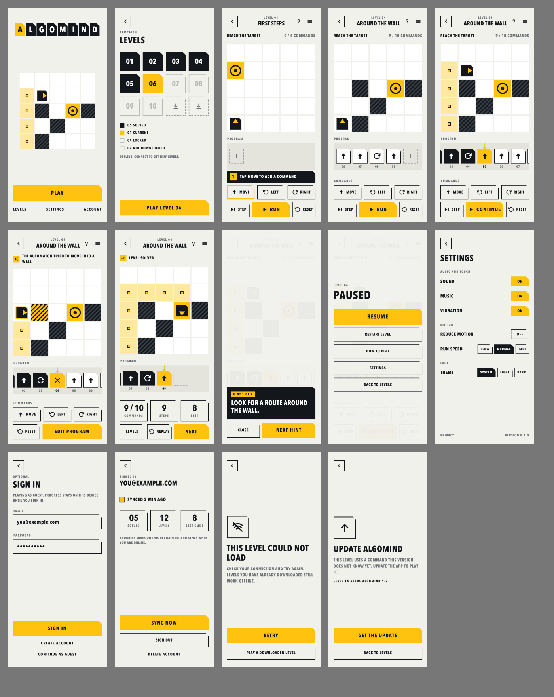

# Algomind

**A programming puzzle for Android.** Build a program from instruction tiles, run it, and guide a small automaton to the target. Offline first. No ads. No purchases.

[](https://github.com/shahadathhs/Algomind/actions/workflows/ci.yml)

> **Status: first playable build, not released.** The game, the level pipeline (API and dashboard), and the public site are built. It has not been run on a device, accounts and cloud sync are not built, and no app release has been published. [What is built, and what is not](#status) is spelled out below.

## Live

|         |                                                                                                       |
| ------- | ----------------------------------------------------------------------------------------------------- |
| Website | https://playalgomind.vercel.app (the live site runs the code from `main`; this branch is ahead of it) |
| API     | https://algomind-api.onrender.com (health: `/v1/health`, docs: `/docs`)                               |

The API runs on Render's free tier, so the first request after a quiet period can be slow. There is no published app release at the moment; the first one is created by the next merge to `main`.



_Design renders of the planned app screens (light theme). They are design targets, not screenshots of the running app._

## The idea

Most puzzle games ask you to react. Algomind asks you to think like a programmer: look at a small board, plan a short sequence of instructions, run it, watch exactly what happens, and fix your mistake. No joystick, no timer, no lives.

It teaches computational thinking through play, one idea at a time (sequencing, turning, planning, limits, loops), and it never requires you to know how to code.

## How it plays

Each level is a small grid with walls, a target, and a tiny automaton that starts somewhere, facing some direction. You build a **program** on the **tape** from a handful of instruction tiles, press Run, and the automaton carries it out one step at a time.

| Command        | What it does                                       |
| -------------- | -------------------------------------------------- |
| `MOVE_FORWARD` | Move one cell in the direction the automaton faces |
| `TURN_LEFT`    | Turn 90° counterclockwise without moving           |
| `TURN_RIGHT`   | Turn 90° clockwise without moving                  |

Loops (`REPEAT`), conditions (`IF_FRONT_BLOCKED`), and interactive objects arrive later, each introduced by a level designed to teach it.

- **Deterministic.** The same level and the same program always give the same result, so puzzles are fair and testable.
- **Clear failure.** If the automaton walks into a wall, the game says so in plain words and marks the wall and the instruction that caused it. You edit and retry.
- **Constraints, not tricks.** Levels can limit how many instructions you may use. A built-in solver knows the shortest possible program (the "par"), so the game can show your result against it.
- **Any valid solution counts**, unless a level is explicitly an optimization challenge.

Levels are grouped into **worlds** (one concept each) and **chapters** within them, and unlock in order.

## Why it is built the way it is

- **Offline first.** Progress saves on the device. Downloaded levels stay playable without a connection. Signed-out play uploads nothing.
- **Optional account.** Sign in only if you want your progress synced across devices; local and cloud progress are merged, never overwritten.
- **New levels without an update.** Levels are data, published from a dashboard and downloaded by the app. New layouts and combinations of existing mechanics reach players without a new app release.
- **No tracking.** No ads, no purchases, no analytics, no third-party scripts on the website.
- **Light and dark themes**, both first-class, with every state readable without relying on color alone.

## How it fits together

```text
                    ┌────────────────────────────────────┐
                    │ Web app (Next.js)                  │
                    │  public site: download first       │
                    │  admin dashboard: author + publish │
                    └─────────────────┬──────────────────┘
                                      │ HTTPS
                                      ▼
┌──────────────────┐          ┌───────────────────────┐
│ Game (Godot)     │─────────▶│ API (NestJS)          │
│ Android first    │  HTTPS   │ auth, levels, publish │
│ offline cache    │◀─────────│ validation, solver    │
└──────────────────┘          └───────────┬───────────┘
                                          │ Prisma
                                          ▼
                                 ┌─────────────────┐
                                 │ PostgreSQL      │
                                 └─────────────────┘

   packages/level-contract   one rule set: schema, validator, simulator, solver, fixtures
   packages/design-tokens    one source of colors for the game and the web
```

**One rule set, several implementations.** The reference simulator (TypeScript) and the game's simulator (GDScript) must agree on every shared fixture. The dashboard preview, the API's publish check, and the game therefore produce identical results.

**Content pipeline.** An admin creates a level in the dashboard, solves it on the same tape editor as the game, and the solver computes par. A level cannot be published until it validates, its reference solution solves it, a playtest is recorded for its current content, and the deployed app can play it. Published versions are immutable; edits create a new draft version.

## Tech stack

| Part    | Technology                                                                             |
| ------- | -------------------------------------------------------------------------------------- |
| Game    | Godot 4.7, GDScript, GUT tests, gdtoolkit (gdlint, gdformat)                           |
| API     | NestJS 12 (ES modules, built with SWC), Prisma 7, PostgreSQL 17                        |
| Web     | Next.js 16, React 19, Tailwind CSS 4                                                   |
| Shared  | TypeScript 7, pnpm workspace, generated design tokens                                  |
| Tooling | oxlint (type-aware), prettier, husky, lint-staged, commitlint, Conventional Commits    |
| Ops     | Docker and Docker Compose, GitHub Actions, Render (API), Neon (database), Vercel (web) |

## Status

| Area                         | Built                                                                                                                                                                                                                                                                                                                                                                                                                                                                                                                                                                                                                                  | Not built yet                                                                                                                                              |
| ---------------------------- | -------------------------------------------------------------------------------------------------------------------------------------------------------------------------------------------------------------------------------------------------------------------------------------------------------------------------------------------------------------------------------------------------------------------------------------------------------------------------------------------------------------------------------------------------------------------------------------------------------------------------------------- | ---------------------------------------------------------------------------------------------------------------------------------------------------------- |
| **Specification and design** | Product, rules, architecture, visual design system ("Instruction Tape"), plans for the web and the dashboard, 15 app screens in both themes, web and dashboard renders                                                                                                                                                                                                                                                                                                                                                                                                                                                                 |                                                                                                                                                            |
| **Engineering foundation**   | Monorepo, hooks, lint and format gates, a color-literal gate, design-token generator with contrast tests, version and release scripts, Docker and Compose, CI/CD workflow                                                                                                                                                                                                                                                                                                                                                                                                                                                              | The Render and Vercel deploy hooks are configured but have not been exercised by a pipeline run yet                                                        |
| **API**                      | Deployed on Render with Neon: health routes, OpenAPI docs, error format, validated config, authentication with rotating refresh tokens and a seeded admin, levels with draft and immutable published versions, worlds and chapters with campaign ordering, the public catalog (`/v1/campaign`, `/v1/levels`), gated publishing (validator, reference solution, solver par, playtest, client compatibility, placement), import and export, client registry, audit log, starter campaign seed, optional player accounts with progress sync and account deletion, and 46 unit tests (publish gates, authorization, sessions, merge rules) | A database-backed test suite (the publish gates and authorization are unit tested; constraints and the immutability trigger are checked in CI and by hand) |
| **Web**                      | Public site (landing, how to play, levels, download with the latest release, privacy, contact, icons, share images, sitemap), and the admin dashboard: sign-in and session handling, the level list and editor (board, solution tape, preview, playtests, checks, publish), history with export and restore, campaign ordering, import, capabilities, and the audit log                                                                                                                                                                                                                                                                | Publish review with diff, unpublish and archive controls, level thumbnails, home counts                                                                    |
| **Game**                     | A playable game: Menu, Worlds and World, play (board, tape editor, Run, Step, Pause, Reset, par on the result), first-run coach, Hint, Pause menu, How to play, Settings (sound, music, vibration, reduce motion, run speed, theme), Load error, Update required, Sign in and Account screens; optional accounts that sync progress (it merges, never overwrites); levels downloaded from the API and cached on the device with an offline fallback; local progress with safe saves; the GDScript validator and simulator reproduce every contract fixture; 169 GUT tests; a signed debug APK build                                    | Hints beyond the starter levels; no device or APK run of the game yet                                                                                      |
| **Level contract**           | Schema, validator, deterministic simulator, shortest-solution solver, and a language-neutral fixture suite (126 tests)                                                                                                                                                                                                                                                                                                                                                                                                                                                                                                                 | Wiring into the dashboard and the game's level loading (the API uses it)                                                                                   |

The order of work is in the [implementation plan](docs/README_IMPLEMENTATION_PLAN.md).

## Getting started

You need Node 22+, pnpm, Docker, and `make`. For the game you also need Godot 4.7 and [uv](https://docs.astral.sh/uv/) (or use the Docker targets).

```sh
make setup      # .env (with a generated local database password), dependencies and hooks, database in Docker, migrations, Godot cache
make api-dev    # API at http://localhost:8000 (docs at /docs)
make web-dev    # web at http://localhost:3000
make game-run   # the game on this machine
make game-shots # debug screenshots of every screen (3 phone sizes, both themes) into apps/game/build/shots
```

Or run everything in containers:

```sh
make up         # database, API, and web (http://localhost:3000, http://localhost:8000)
make down       # stop
```

## Commands

`make help` lists everything. The common ones:

```sh
make check              # everything CI runs
make lint               # oxlint (type-aware) + prettier --check
make typecheck          # tsc in every TypeScript package
make test               # TypeScript tests
make game-test          # GDScript tests (GUT, includes the contract fixtures); make game-docker-test runs them in a container
make tokens-check       # fail if generated design-token files are out of date
make colors-check       # fail if a color is hand-written outside the design tokens
make size-check         # fail if a source file is over 450 lines (lists files over 300)
make db-reset           # throw away the local database and start fresh
make game-apk           # build a debug APK (in the Godot container)
make version v=0.2.0    # bump the version everywhere (no git); make release also commits and pushes
```

## Quality and delivery

- **Gates on every push and pull request:** design-token drift, hand-written colors, type-aware lint and formatting, type checks, tests, a clean-database migration check for the API, production builds, GDScript lint and headless Godot tests, and a container smoke test that starts the database, API, and web together.
- **On `main`:** deploy the API to Render and wait for it to go live, build a signed debug APK, refresh a rolling "latest build" release, and publish a versioned release when the `VERSION` file names a new version.
- **Conventional Commits** are enforced by a hook. Work happens on `dev` and reaches `main` through a pull request.

Details: [CI, CD, and releases](docs/CI.md) and [deployment](docs/DEPLOY.md).

## Distribution

Algomind will be distributed as an Android APK from GitHub Releases, with a download page on the website that explains installation. It is not planned for Google Play.

## Repository

```text
apps/
  game/            Godot project (Android first)
  api/             NestJS API, Prisma, PostgreSQL
  web/             Next.js: public site + admin dashboard
packages/
  design-tokens/   Theme tokens and generators (Godot palette, web CSS)
  level-contract/  Schema, validator, simulator, solver, fixtures
docs/              Specification, design renders, CI and deploy notes
docker/            Godot container and Android setup
scripts/           Version bump and repository checks
```

## Docs

- [Project overview](docs/README_PROJECT_OVERVIEW.md): goals, scope, success criteria
- [Game rules](docs/README_GAME_RULES.md): commands, execution, progress, sync, publishing
- [Gameplay and features](docs/README_GAMEPLAY_FEATURES.md)
- [Visual design](docs/README_VISUAL_DESIGN.md) and [screens](docs/design/SCREENS.md)
- [Architecture](docs/README_ARCHITECTURE.md)
- [Code standards](docs/README_CODE_STANDARDS.md): file size, module structure, reuse rules
- [Public website plan](docs/README_WEB_PLAN.md) and [admin dashboard plan](docs/README_DASHBOARD_PLAN.md)
- [Roadmap](docs/README_ROADMAP.md) and [TODO](TODO.md)
- [Points, leaderboards, daily challenge, and sharing plan](docs/README_SOCIAL_PLAN.md)
- [Implementation plan](docs/README_IMPLEMENTATION_PLAN.md)
- [CI, CD, and releases](docs/CI.md) and [deployment](docs/DEPLOY.md)

## Contributing

See [CONTRIBUTING.md](CONTRIBUTING.md) for setup and house rules, and [AGENTS.md](AGENTS.md) for the rules AI coding tools follow here. Everyone is expected to follow the [Code of Conduct](CODE_OF_CONDUCT.md).

## License

[MIT](LICENSE)

## Security

Report vulnerabilities privately; see [SECURITY.md](SECURITY.md).
